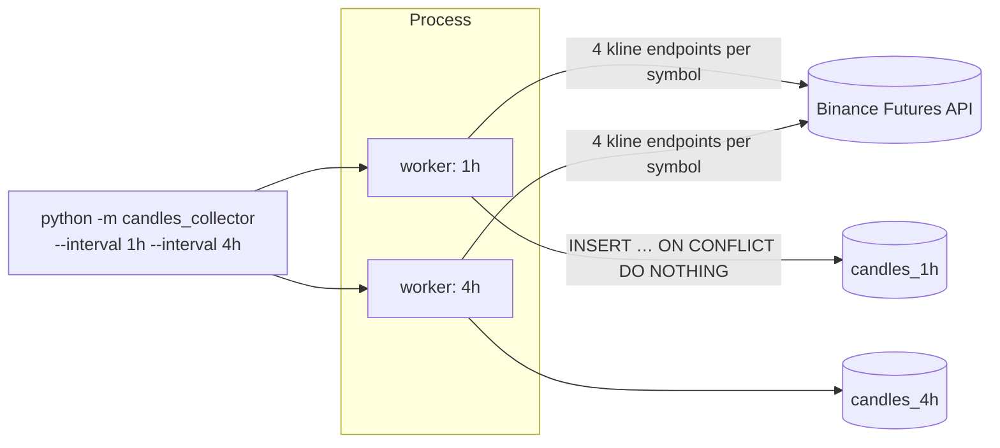

# binance-candles-collector

[](https://github.com/nikkibraiam/binance-candles-collector/actions/workflows/ci.yml)

Collects **closed** candlesticks from the public Binance USDⓈ-M Futures API into
PostgreSQL, for 9 intervals (1m → 1w) and 4 price series per symbol, as the
data layer for backtesting and indicator calculation.

## What it collects

For every symbol and interval it polls four endpoints and stores each one with
its own `candle_type`:

| `candle_type` | Endpoint | Series |
|---|---|---|
| `klines` | `/fapi/v1/klines` | Last traded price |
| `continuosKlines` | `/fapi/v1/continuousKlines` (`PERPETUAL`) | Continuous perpetual contract |
| `indexKlines` | `/fapi/v1/indexPriceKlines` | Index price |
| `markKlines` | `/fapi/v1/markPriceKlines` | Mark price |

Each request reads the latest 1000 candles; the last one is still open and is
discarded, so only final values are stored.

## Architecture



```
src/candles_collector/
├── __main__.py   CLI, one worker thread per interval, graceful shutdown
├── collector.py  polling loop (fetch → parse → store), isolated per symbol
├── binance.py    endpoint definitions, URL building, HTTP client
├── models.py     Candle dataclass and kline parsing (Decimal, drops open candle)
├── db.py         PostgreSQL store, idempotent batch insert
└── config.py     settings from environment / .env
sql/schema.sql    candles_<interval>, indicators and index_<interval> tables
```

## Running

```bash
cp .env.example .env              # fill in the database password

# Local Postgres with the schema + a 1h collector
docker compose up --build

# Or directly
pip install -e .
python -m candles_collector --interval 1h --interval 1d
python -m candles_collector       # all intervals (or the ones in $INTERVALS)
```

| Variable | Default | Notes |
|---|---|---|
| `BINANCE_URL` | `https://fapi.binance.com` | |
| `HOST_DATABASE` / `PORT_DATABASE` | `localhost` / `5432` | PgBouncer works too |
| `USER_DATABASE` / `PASS_DATABASE` / `NAME_DATABASE` | `postgres` / – / `bot-trading` | |
| `INTERVALS` | all | comma-separated, e.g. `1h,4h` |
| `SYMBOLS` | 14 large-cap USDT pairs | comma-separated |
| `SYMBOL_PAUSE_SECONDS` | `60` | pause between symbols |

## Development

```bash
pip install -e ".[dev]"
ruff check . && ruff format --check .
pytest
```

Tests cover kline parsing, URL building, the HTTP client (mocked) and the
polling loop with a fake client and store; no network or database needed.

## Design notes

- **Idempotent writes.** Every poll re-reads a 1000-candle window that mostly
  overlaps the previous one. A unique key on `(candle_type, crypto, open_time)`
  plus `ON CONFLICT DO NOTHING` makes re-reads free and safe after restarts,
  with one batched statement per series instead of a lookup + insert per row.
- **Only closed candles.** The newest candle changes until its interval ends;
  storing it would require updates and give indicators a moving target.
- **Exact numbers.** Prices are parsed as `Decimal` and stored as
  `numeric(24,8)`; low-priced pairs like DOGE or TRX need the decimals.
- **Failure isolation.** A failed request skips that series; a failed symbol is
  logged and the loop moves on. One thread and one DB connection per interval,
  since psycopg2 connections must not be shared across threads.
- **Rate limits.** 4 requests per symbol and a pause between symbols keep the
  request weight far below Binance's per-minute limit, even with all 9
  intervals running.
- **Safe SQL.** Table names come from a fixed allow-list and are composed with
  `psycopg2.sql.Identifier`; values are always bound parameters.

Note: `MATICUSDT` stopped trading after the MATIC → POL migration; it stays in
the default list for continuity of existing data. Override it with `SYMBOLS`.

## History

Started in 2023 as nine copies of the same script, one per interval, written
together with Matthew, who contributed the persistence flow and the dependency
setup. This version consolidates them into a single tested package and fixes
data issues found along the way: a 4h worker that was collecting 1h candles,
deduplication that ignored the symbol, and column sizes that could not hold
some symbols and prices.

## License

MIT
